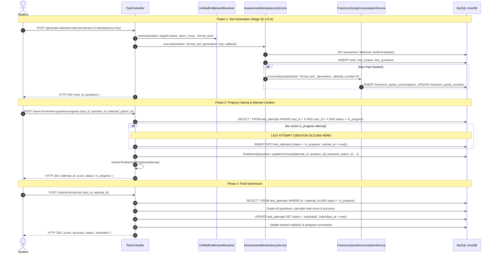

# Stage 1E.2.D.B — Current Attempt Lifecycle Map

**Document ID:** `PHASE_1E_2_D_B_CURRENT_ATTEMPT_LIFECYCLE_MAP`  
**Repository:** `E:\Al-Faraabi Software\3peas_backend`  
**Stage:** 1E.2.D.B — Shared Official-Test Uniqueness, Attempt & Retake Accounting (Planning Mode)  
**Timestamp:** 2026-11-19  

---

## 1. End-to-End Attempt Lifecycle in Current Code

The assessment workflow spans three phases: Generation, Progress Autosave, and Final Submission.

---

## 2. Key Architectural Observations

1. **Attempt Creation is Lazy:**
   - Neither `generateSelectedUnitsFormalTestForLms` nor `generateFullBookFormalTestForLms` creates a `TestAttempt` record.
   - The `TestAttempt` is created lazily on the student's **first progress save** (`saveFormalTestQuestionProgressForLms`, lines 639–652), or on direct submission if no progress was autosaved.
2. **Missing Quota & Eligibility Enforcement on Progress Save:**
   - In current `saveFormalTestQuestionProgressForLms` (lines 617–653), `TestAttempt::create` is executed **without** checking whether the student has quota remaining, whether the test allows retakes, or whether the attempt cap was reached.
   - Any student can currently trigger unmetered attempts and retakes simply by calling `/save-formal-test-question-progress`.
3. **No Ledger Event Recorded for Attempts:**
   - When `TestAttempt::create` executes, it does **not** call `FreemiumQuotaConsumptionService::consumeQuota()` with `attempt_start` or `retake_start`.
   - The ledger only contains the initial `generation` event (`attempt_number = 0`).
4. **Missing Ownership Check on Progress Save & Submission:**
   - `saveFormalTestQuestionProgressForLms` calls `Test::findOrFail($validated['test_id'])` but fails to verify that the test belongs to `$user->id` or is an official published shared test (`test_source === 'official' && is_published = 1`).
   - A student can attempt another student's generated test if they possess the `test_id`.
5. **Autosave Reuses Active Attempt:**
   - When `TestAttempt::where('test_id', $test->id)->where('user_id', $user->id)->where('status', 'in_progress')->first()` finds an existing attempt, it reuses it.
   - Subsequent question answers and modifications do not create new attempts or consume credits.
