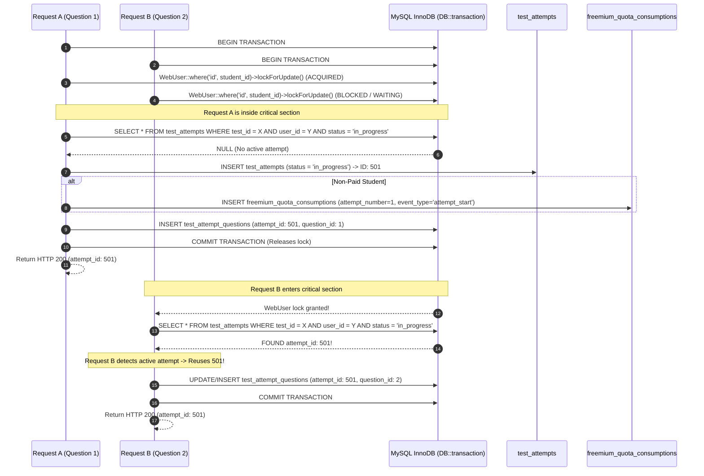

# Stage 1E.2.D.B — Idempotency and Concurrency Design

**Document ID:** `PHASE_1E_2_D_B_IDEMPOTENCY_AND_CONCURRENCY_DESIGN`  
**Repository:** `E:\Al-Faraabi Software\3peas_backend`  
**Stage:** 1E.2.D.B — Shared Official-Test Uniqueness, Attempt & Retake Accounting (Planning Mode)  
**Timestamp:** 2026-11-19  

---

## 1. Concurrency Architecture & Operation Separation

Assessment operations are partitioned into distinct concurrency scopes:

| Operation | Concurrency Threat | Locking Mechanism | Unique DB Constraint | Conflict / Race Outcome |
|---|---|---|---|---|
| **Op-1: Initial Attempt Start** | Student double-clicks start; two parallel requests race to create attempt #1. | Pessimistic lock on student parent row (`WebUser::lockForUpdate()`) inside atomic transaction. | `uk_test_user_attempt_event` on `(test_id, user_id, 1, 'attempt_start')` in `freemium_quota_consumptions`. | Winner creates Attempt #1. Loser enters lock, sees active `in_progress` attempt, and reuses it without duplicate creation (safe idempotent join). |
| **Op-2: Retake Start** | Two parallel requests race to consume the final remaining retake credit. | `WebUser::lockForUpdate()` serializes retake eligibility check. | `uk_test_user_attempt_event` on `(test_id, user_id, 2, 'retake_start')`. | Winner creates Attempt #2. Loser sees attempt cap reached and receives HTTP 403 `QUOTA_EXHAUSTED`. |
| **Op-3: Shared Official Test Start** | Two different students start the same official test at the exact same millisecond. | No cross-student locks needed. Independent row-level locks on respective `WebUser` rows. | Compound unique index `(test_id, user_id, attempt_number, event_type)`. | Both students succeed with HTTP 200 independently without storage engine collision. |
| **Op-4: Question Progress Autosave** | Two autosave requests for different questions (or same question) race in background. | Row-level locking on `TestAttempt` or optimistic upsert. | `(attempt_id, question_id)` in `test_attempt_questions`. | `updateOrCreate` cleanly updates answer option. Does NOT use generation idempotency key. Legitimate subsequent answer changes are never blocked. |
| **Op-5: Submission vs Autosave Race** | Autosave arrives while attempt is being finalized. | `TestAttempt::where('id', $attemptId)->lockForUpdate()`. | Attempt status transitions from `'in_progress'` to `'submitted'`. | Autosave detects `status === 'submitted'` and returns HTTP 409 Conflict ("Test attempt has already been submitted"). Final score is preserved. |
| **Op-6: Failed Attempt Creation** | DB deadlock or exception occurs during question fetching or initialization. | Atomic `DB::transaction()` wrapping attempt creation and ledger logging. | Rollback reverts `test_attempts` and `freemium_quota_consumptions`. | Transaction rolls back completely; zero orphaned attempt or consumption rows exist. |

---

## 2. Lock Ordering & Deadlock Prevention

To eliminate MySQL deadlock cycles (`Deadlock found when trying to get lock; try restarting transaction`), transactions must acquire locks in strict canonical order:

1. **Lock WebUser Parent Row:**
   ```php
   WebUser::query()->where('id', $student->id)->lockForUpdate()->first();
   ```
2. **Lock or Query Test Entity:**
   ```php
   $test = Test::query()->where('id', $testId)->first();
   ```
3. **Query Active Attempts:**
   ```php
   $activeAttempt = TestAttempt::query()
       ->where('test_id', $testId)
       ->where('user_id', $student->id)
       ->where('status', 'in_progress')
       ->lockForUpdate()
       ->first();
   ```
4. **Mutate Entities & Ledger:**
   - Insert `test_attempts`.
   - Insert `freemium_quota_consumptions`.
5. **Commit Transaction.**

All participating models reside on the same default MySQL connection (`config('database.default')`).

---

## 3. Serialization of Concurrent Active Attempts

### 3.1 The Race Condition
When a student initiates an assessment (or double-clicks start, or two question autosaves dispatch simultaneously on page load), two HTTP requests (`Request A` and `Request B`) hit `/save-formal-test-question-progress` at the exact same millisecond for the same student and test.

### 3.2 The Strict Serialization Guarantee
To ensure **exactly one** active `TestAttempt` is created:



### 3.3 Storage Engine Level Defense-in-Depth
1. **Application & Database Lock:**
   The transaction boundary and `WebUser::lockForUpdate()` ensure that `Request B` is physically queued behind `Request A`. When `Request B` unblocks, it reads the committed row (`attempt_id: 501`) and reuses it.
2. **Freemium Unique Compound Index:**
   Even in the theoretical event of application lock bypass, the InnoDB unique constraint `uk_test_user_attempt_event` on `(test_id, user_id, attempt_number, event_type)` rejects any duplicate attempt logging with Error 1062, forcing rollback of the duplicate transaction.

### 3.4 Distinguishing Attempt-Start Idempotency from Answer Updates
- **Attempt-Start Idempotency:**
  Starting an attempt is serialized and idempotent: if an active `in_progress` attempt exists for `(test_id, user_id)`, the system binds to it. It never spawns parallel active attempts for the same student on the same test.
- **Legitimate Answer Updates:**
  Saving or modifying answers does **NOT** require an `X-Idempotency-Key` and is **NOT** blocked by attempt-start deduplication.
  The storage key for answers is `(attempt_id, question_id)` in `test_attempt_questions`.
  Using `TestAttemptQuestion::updateOrCreate(...)`, a student can freely change Option A to Option C, update time spent, or revise answers at any time during an active attempt. Answer updates never consume additional attempt credits or create ledger records.
