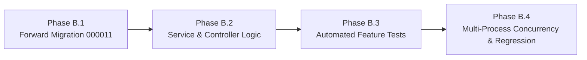

# Stage 1E.2.D.B — Final Implementation Roadmap

**Document ID:** `PHASE_1E_2_D_B_IMPLEMENTATION_ROADMAP`  
**Repository:** `E:\Al-Faraabi Software\3peas_backend`  
**Stage:** 1E.2.D.B — Shared Official-Test Uniqueness, Attempt & Retake Accounting (Planning Mode)  
**Timestamp:** 2026-11-19  

---

## 1. Sequential Execution Roadmap

Stage 1E.2.D.B execution is partitioned into 4 safe, verifiable sequential phases:

---

### Phase B.1: Forward Migration Creation & Local Schema Execution
- **Step 1:** Create `database/migrations/2026_12_01_000011_update_freemium_test_attempt_unique_index.php`.
- **Step 2:** Implement `up()`:
  - Drop unique index `uk_test_attempt_event` from `freemium_quota_consumptions`.
  - Add compound unique index `uk_test_user_attempt_event` on `(test_id, user_id, attempt_number, event_type)`.
- **Step 3:** Implement fail-closed `down()`:
  - Check for multiple distinct student attempts on the same official test; throw `\RuntimeException` if any exist.
  - Drop `uk_test_user_attempt_event` and restore `uk_test_attempt_event`.
- **Step 4:** Execute migration strictly against local development (`3peas_db`) and local test (`3peas_db_subscription_test`).

---

### Phase B.2: Service & Controller Integration
- **Step 1:** In `FreemiumQuotaConsumptionService.php`:
  - Enhance `getTestAttemptEligibility` to support student ownership verification and return exact attempt state (`is_retake`, `attempt_number`, `can_attempt`, `remaining_attempts`).
  - Add `consumeAttemptQuota(WebUser $student, Test $test, int $attemptNumber, string $eventType, ?array $options = [])` to record `attempt_start` and `retake_start` in `freemium_quota_consumptions`.
- **Step 2:** In `TestController.php`:
  - Update `saveFormalTestQuestionProgressForLms`:
    - Enforce ownership and security check (reject unowned non-official tests with safe 404).
    - If no active `in_progress` attempt exists:
      - Resolve entitlement via `UnifiedEntitlementResolver`.
      - Check eligibility via `getTestAttemptEligibility` (reject with 403 `QUOTA_EXHAUSTED` if denied).
      - Acquire pessimistic student lock `WebUser::lockForUpdate()`.
      - Create `TestAttempt` (`status = 'in_progress'`).
      - If non-paid: call `consumeAttemptQuota` to record `attempt_start` or `retake_start`.
    - If attempt exists:
      - Reject if `status === 'submitted'` with HTTP 409 Conflict.
      - Save answer via `TestAttemptQuestion::updateOrCreate`.
  - Update `submitFormalTestForLms`:
    - Enforce ownership check (reject unowned non-official tests with 404).
    - Acquire pessimistic lock on `TestAttempt`.
    - Grade questions, calculate score and accuracy, update `status = 'submitted'`, `submitted_at = now()`.

---

### Phase B.3: Automated Feature Testing
- Implement `tests/Feature/Freemium/Student/StudentFormalTestAttemptAccountingTest.php` covering:
  1. Two students attempting the same official test without collision.
  2. Sequential initial attempt and permitted retake.
  3. Retakes disabled (`allow_retakes = false`).
  4. Attempt limit cap (`max_attempts_per_test`).
  5. Abandoned attempt allowance burn.
  6. In-progress attempt resume without extra attempt consumption.
  7. Paid subscriber bypass (creates `TestAttempt` with zero freemium ledger rows).
  8. Cross-student unowned test access rejection (HTTP 404).

---

### Phase B.4: Multi-Process Concurrency & Regression Verification
- Implement `tests/Feature/Freemium/Concurrency/AssessmentAttemptConcurrencyTest.php` covering:
  1. Multi-process concurrent attempt starts on shared official test.
  2. Multi-process concurrent retake race condition (last credit exhaustion).
  3. Submission vs autosave race condition.
- Run full Freemium test suite (204+ tests) and regression suite (`StudentClassSubscriptionIntegrationTest`).
- Verify zero regressions across `TestController` and `PracticeSessionController`.

---

## 2. Stop Condition
Stage 1E.2.D.B planning is complete. Implementation will begin only upon explicit user authorization.
