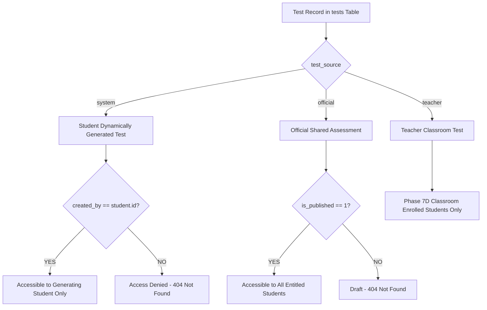

# Stage 1E.2.D.B — Ownership and Security Audit

**Document ID:** `PHASE_1E_2_D_B_OWNERSHIP_AND_SECURITY_AUDIT`  
**Repository:** `E:\Al-Faraabi Software\3peas_backend`  
**Stage:** 1E.2.D.B — Shared Official-Test Uniqueness, Attempt & Retake Accounting (Planning Mode)  
**Timestamp:** 2026-11-19  

---

## 1. Test Ownership Classification

The LMS backend supports multiple distinct test categories:



### Verified Differentiation Rules
1. **Student Generated Custom Tests:**
   - Identified by: `test_source === 'system'` AND `created_by === $student->id`.
   - Access Scope: Strictly private to the student who generated it.
2. **Official Shared Assessments:**
   - Identified by: `test_source === 'official'` AND `is_published === 1`.
   - Access Scope: Shared publicly across all authenticated students possessing appropriate subject/program entitlement.
3. **Teacher Assigned Classroom Tests:**
   - Identified by: `test_source === 'teacher'`.
   - Access Scope: Governed exclusively by classroom enrollment and Phase 7D test delivery tables (`teacher_class_tests`).

---

## 2. Identified Security Vulnerability & Remediation

### Verified Source Inspection Finding
In `app/Http/Controllers/Tests/TestController.php`:
- Line 619 (`saveFormalTestQuestionProgressForLms`):
  ```php
  $user = $request->user();
  $test = Test::findOrFail($validated['test_id']);
  ```
- Line 861 (`submitFormalTestForLms`):
  ```php
  $user = $request->user();
  $test = Test::query()->with(['questions', 'scopes'])->findOrFail($validated['test_id']);
  ```
**Vulnerability Analysis:** Neither method verifies that the test belongs to the authenticated student or is an official published assessment! A malicious or curious student who discovers another student's `test_id` can:
1. Save progress against another student's test.
2. Submit and trigger grading against another student's test questions.
3. Probe question IDs and answer options attached to another student's private test.

### Architectural Remediation
In `FreemiumQuotaConsumptionService::getTestAttemptEligibility()` (lines 679–704), an authoritative ownership check already exists:
```php
$isStudentOwned = ($test->created_by === $student->id || $hasConsumption || $hasAttempt);
$isOfficialShared = ($test->test_source === 'official' && (bool) $test->is_published);

if (!$isStudentOwned && !$isOfficialShared) {
    return [
        'eligible'      => false,
        'code'          => 'test_not_found',
        'denial_reason' => 'Test not found or access denied.',
    ];
}
```
**Remediation in Stage 1E.2.D.B Implementation:**
In both `saveFormalTestQuestionProgressForLms` and `submitFormalTestForLms`, before creating or mutating any attempt, enforce this exact check. If access is denied, fail closed with HTTP 404 `Not Found` (`Test not found or access denied.`), preventing test ID enumeration.
