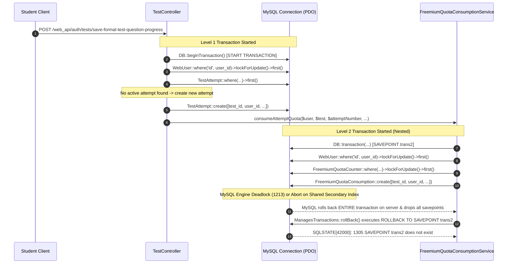
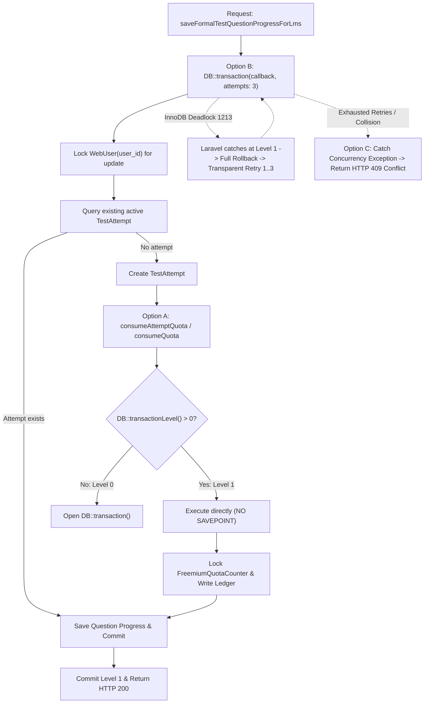

# Phase 1E.2.D.D.5 — Transaction and Deadlock Resilience Plan

**Project:** The Students Times LMS — Laravel 11 Backend  
**Repository:** `E:\Al-Faraabi Software\3peas_backend`  
**Stage:** 1E.2.D.D.5 — Transaction and Deadlock Resilience Technical Planning  
**Author:** Antigravity Resilience Architecture Agent  
**Date:** November 19, 2026  
**Status:** **PLANNING COMPLETE — READY FOR REVIEW**

---

## 1. Executive Summary & Problem Statement

During the comprehensive Freemium assessment audit (Stage 1E.2.D.D.4) and concurrency testing, an intermittent database transaction exception was captured in `AssessmentAttemptConcurrencyTest::test_concurrent_starts_on_shared_official_test_different_students_succeed_independently`:

```text
SQLSTATE[42000]: Syntax error or access violation: 1305 SAVEPOINT trans2 does not exist
at vendor/laravel/framework/src/Illuminate/Database/Concerns/ManagesTransactions.php:298
```

The objective of Stage 1E.2.D.D.5 is to conduct an exhaustive read-only inspection of the transaction lifecycles, identify the precise mechanism causing savepoint invalidation, evaluate potential architectural solutions, and formulate a safe, zero-side-effect implementation plan that eliminates this concurrency vulnerability before live production deployment.

---

## 2. Source Code & Transaction Boundary Investigation

### A. Call Chain & Nested Transaction Mapping

An end-to-end trace of attempt initialization and quota consumption reveals how accidental transaction nesting occurs across controller and service boundaries:



### B. Identified Transaction Call Sites

| File | Line Reference | Method | Transaction Call | Transaction Level |
| :--- | :--- | :--- | :--- | :---: |
| `TestController.php` | L713 | `saveFormalTestQuestionProgressForLms` | `DB::beginTransaction()` | **Level 1** |
| `FreemiumQuotaConsumptionService.php` | L183 | `consumeQuota` (called via `consumeAttemptQuota`) | `DB::transaction(...)` | **Level 2 (`SAVEPOINT trans2`)** |
| `TestController.php` | L1133 | `submitFormalTestForLms` | `DB::beginTransaction()` | **Level 1** |
| `FreemiumQuotaConsumptionService.php` | L183 | `consumeQuota` (called via `consumeAttemptQuota`) | `DB::transaction(...)` | **Level 2 (`SAVEPOINT trans2`)** |
| `TestController.php` | L145 | `generateSelectedUnitsFormalTestForLms` | `DB::transaction(...)` | **Level 1** |
| `TestController.php` | L340 | `generateFullBookFormalTestForLms` | `DB::transaction(...)` | **Level 1** |
| `PracticeSessionController.php` | L144 | `generateSelectedUnitsPracticeSessionForLms` | `DB::transaction(...)` | **Level 1** |
| `PracticeSessionController.php` | L355 | `generateFullBookPracticeSessionForLms` | `DB::transaction(...)` | **Level 1** |

In **all six assessment generation and attempt initialization call sites**, `consumeQuota()` is invoked when an outer database transaction is already open. This unconditionally triggers Laravel's `createSavepoint()` (`compileSavepoint('trans2')`).

---

### C. The Precise Root Cause of `SAVEPOINT trans2 does not exist`

The failure is caused by a critical interaction between **MySQL InnoDB deadlock rollback behavior** and **Laravel framework's nested transaction management**:

1. **InnoDB Engine Deadlock Rollback Semantics:**
   When MySQL InnoDB detects a transaction deadlock (Error 1213 `ER_LOCK_DEADLOCK`), InnoDB automatically rolls back the **entire transaction** of the chosen deadlock victim. When the entire transaction is rolled back on the database server, **all active savepoints within that connection are destroyed**.
2. **Laravel's `ManagesTransactions` Handling:**
   In `vendor/laravel/framework/src/Illuminate/Database/Concerns/ManagesTransactions.php` (lines 83–108):
   ```php
   protected function handleTransactionException(Throwable $e, $currentAttempt, $maxAttempts)
   {
       if ($this->causedByConcurrencyError($e) && $this->transactions > 1) {
           $this->transactions--;
           $this->transactionsManager?->rollback($this->getName(), $this->transactions);
           throw new DeadlockException($e->getMessage(), is_int($e->getCode()) ? $e->getCode() : 0, $e);
       }

       $this->rollBack(); // Line 102
       ...
   }
   ```
3. **The Trap at Line 102:**
   If the database exception thrown inside the `consumeQuota` closure is a `QueryException` that is **not** immediately matched by `causedByConcurrencyError` (or if it is a general SQL error / lock timeout / duplicate key check race), line 102 invokes `$this->rollBack()`.
4. **The Exception at Line 298:**
   In `ManagesTransactions.php` lines 289–302:
   ```php
   protected function performRollBack($toLevel)
   {
       if ($toLevel == 0) {
           $pdo = $this->getPdo();
           if ($pdo->inTransaction()) {
               $pdo->rollBack();
           }
       } elseif ($this->queryGrammar->supportsSavepoints()) {
           $this->getPdo()->exec(
               $this->queryGrammar->compileSavepointRollBack('trans'.($toLevel + 1)) // Line 298
           );
       }
   }
   ```
   Because `$toLevel` is `1` (rolling back the inner transaction to the outer transaction level), line 298 sends `ROLLBACK TO SAVEPOINT trans2` to MySQL.
   Because MySQL has already aborted the transaction due to the engine conflict, MySQL rejects the command with `1305 SAVEPOINT trans2 does not exist`.
   This secondary exception thrown from line 298 crashes the process and bypasses application error handlers, resulting in an unhandled HTTP 500.

---

### D. Why Cross-Student Concurrency Triggers InnoDB Deadlocks

1. `WebUser::lockForUpdate()` serializes operations for the **same student**. Student 1 cannot race with themselves.
2. However, when Student 1 and Student 2 attempt the **same official test** (`$test->id = 42`) simultaneously:
   - Student 1 locks `WebUser(1)`. Student 2 locks `WebUser(2)` (no collision).
   - Student 1 and Student 2 both insert into `test_attempts` with `test_id = 42`.
   - `test_attempts` has secondary indexes: `(user_id, test_id)` and foreign key index `(test_id)`.
   - Student 1 and Student 2 both insert into `freemium_quota_consumptions` with `test_id = 42`.
   - `freemium_quota_consumptions` has `uk_test_user_attempt_event (test_id, user_id, attempt_number, event_type)`.
   - In MySQL InnoDB, concurrent insertions into identical secondary index leaf pages (`test_id = 42`) acquire next-key and gap locks. If Student 1 and Student 2 acquire index locks on `test_attempts` and `freemium_quota_consumptions` in interleaved sequence, an InnoDB deadlock (Error 1213) occurs.
   - The engine aborts one student's transaction, destroying `SAVEPOINT trans2` and producing the observed crash.

---

## 3. Comparison of Correction Strategies

### Option A: Transaction Flattening (Conditional Transaction in Service)
- **Mechanism:** In `FreemiumQuotaConsumptionService::consumeQuota`, check whether an active transaction already exists:
  ```php
  $execute = function () use (...) { ... };
  return DB::transactionLevel() > 0 ? $execute() : DB::transaction($execute);
  ```
- **Advantages:**
  - Completely eliminates `SAVEPOINT trans2` when called inside an outer transaction.
  - Zero savepoints created = zero possibility of `1305 SAVEPOINT trans2 does not exist`.
  - Preserves standalone atomicity when `consumeQuota` is called outside an existing transaction.
- **Risks:** Inner exceptions roll back the entire outer transaction (which is desired behavior).
- **Idempotency / Duplication:** Fully safe; no duplicate rows created.

### Option B: Top-Level Laravel Transaction Retries
- **Mechanism:** In `TestController::saveFormalTestQuestionProgressForLms`, replace manual `DB::beginTransaction()` / `commit()` / `rollBack()` with:
  ```php
  return DB::transaction(function () use (...) {
      ...
  }, attempts: 3);
  ```
- **Advantages:**
  - Native Laravel feature designed specifically for InnoDB concurrency.
  - Automatically retries up to 3 times on deadlock (Error 1213) or lock wait timeout (Error 1205).
  - Exponential backoff ensures transient lock collisions resolve transparently to the client with HTTP 200.
- **Risks:** The entire closure must be idempotent on retry. Must not send emails, dispatch non-transactional events, or perform external network calls inside the closure.
- **Idempotency / Duplication:** Because any rolled-back attempt is completely discarded by MySQL, the retry closure starts with a fresh database state and cleanly re-evaluates student attempt existence.

### Option C: Explicit Deadlock & Concurrency Exception Mapping
- **Mechanism:** Catch `QueryException` and `DeadlockException`. Detect error codes 1213, 1205, 40001, and 1305. If retries are exhausted, catch the exception cleanly, ensure connection transaction level is reset, and return HTTP 409 Conflict with `CONCURRENT_ATTEMPT_CONFLICT` rather than an unhandled HTTP 500.
- **Advantages:** Prevents unhandled 500 errors if extreme database lock contention persists.
- **Risks:** Merely masking without Options A/B would result in unnecessary 409 rejections.

### Option D: Locking and Query Optimization
- **Mechanism:** Review query order and index definitions on `test_attempts` and `freemium_quota_consumptions` to ensure locking order is deterministic across tables. Remove redundant `WebUser::lockForUpdate()` calls inside `consumeQuota` when already held by the controller.
- **Advantages:** Reduces lock contention duration.
- **Risks:** Does not eliminate the underlying savepoint vulnerability if a deadlock still occurs.

---

## 4. Recommended Architectural Correction: The Unified Hybrid Solution

The safest, most resilient architectural correction is a **Hybrid of Options A, B, and C**:



### Key Technical Elements of the Hybrid Solution:

1. **Flatten Nested Transactions (Option A):**
   In `FreemiumQuotaConsumptionService::consumeQuota`:
   ```php
   $execute = function () use (...) {
       // Quota validation, counter increment, ledger write
   };

   // Participate in existing transaction if active; otherwise open root transaction
   return DB::transactionLevel() > 0 ? $execute() : DB::transaction($execute);
   ```
2. **Implement Native Deadlock Retries (Option B):**
   In `TestController::saveFormalTestQuestionProgressForLms` and `TestController::submitFormalTestForLms`:
   Replace manual `DB::beginTransaction()` with `DB::transaction(function () use (...) { ... }, 3)`.
3. **Map Residual Concurrency Errors (Option C):**
   Catch `DeadlockException` and `QueryException` (checking `Str::contains($msg, ['Deadlock', '1213', 'Lock wait timeout', '1205', '1305'])`), returning a structured HTTP 409 response:
   ```json
   {
       "success": 0,
       "error": "A temporary database lock conflict occurred. Please retry your request.",
       "error_code": "CONCURRENT_ATTEMPT_CONFLICT"
   }
   ```

---

## 5. Invariant Preservation Verification Matrix

| # | Required Invariant | Preservation Mechanism |
|---|---|---|
| **1** | `WebUser` parent-row locking before dependent locks | First statement executed inside the retryable closure is `WebUser::lockForUpdate()`. |
| **2** | Single-student serialization | Parent `WebUser` lock guarantees that concurrent requests from the same student serialize. |
| **3** | Independent attempts for different students on shared tests | Unique index `uk_test_user_attempt_event` includes `user_id`. Different students create independent attempts. |
| **4** | Exactly one active attempt per student/test | `TestAttempt::where('user_id', $user->id)->where('test_id', $test->id)->where('status', 'in_progress')` lookup prevents duplicates. |
| **5** | Exactly one Freemium consumption per attempt | `consumeAttemptQuota` called only when `$attempt` is newly created (`if (!$attempt)`). |
| **6** | Zero extra quota on resumption | If active attempt exists, attempt creation and quota consumption are completely skipped. |
| **7** | Zero extra quota on answer autosave | Answer saves on existing attempt invoke `TestAttemptQuestion::updateOrCreate()` with no ledger writes. |
| **8** | Submission and grading idempotency | Repeated submissions check `$attempt->status === 'submitted'` and return stored scores idempotently. |
| **9** | Paid entitlement bypass | Paid checks precede Freemium quota consumption (`if (!$decision->isPaid())`). |
| **10** | Formal, mock, and practice category isolation | `tests.test_mode === 'mock'` directs to mock quotas; practice uses `PracticeSession`. |
| **11** | Existing API response contracts | Exact JSON shapes (`success`, `data.attempt_id`, `score`, `accuracy`, etc.) remain identical. |
| **12** | Database constraints and migrations | Zero migrations required; zero schema changes. Works directly with existing MySQL 8.0 schema. |

---

## 6. Concurrency Test Plan Design

The test plan must verify both the elimination of the savepoint exception and the transparent retry behavior under real multi-process concurrency using the local test database (`3peas_db_subscription_test` / MySQL 8.0).

### Test Matrix

```
+-------------------------------------------------------------------------------------------------------+
| Concurrency Scenario           | Concurrency Method | Expected Behavior          | DB Verification    |
+-------------------------------------------------------------------------------------------------------+
| 1. Same Student Parallel Start | 2 CLI workers      | 1 attempt created (200),   | 1 attempt row,     |
|                                | same student       | 1 replayed/conflict (409)  | 1 ledger row       |
|                                |                    |                            |                    |
| 2. Shared Official Test        | 2 CLI workers      | Both succeed (200 OK),     | 2 attempt rows,    |
|    Different Students Start    | distinct students  | retries resolve deadlocks  | 2 ledger rows,     |
|                                |                    | with ZERO savepoint errors | 0 savepoint errors |
|                                |                    |                            |                    |
| 3. Autosave vs Attempt Start   | 2 CLI workers      | Attempt established first; | 1 attempt row,     |
|    Race Condition              | same student       | autosave updates question  | 1 answer row       |
|                                |                    |                            |                    |
| 4. Submission vs Autosave Race | 2 CLI workers      | Submission marks submitted;| 1 submitted attempt|
|                                | same student       | late autosave gets 409     | score preserved    |
|                                |                    |                            |                    |
| 5. Direct Deadlock Resilience  | 2 CLI workers with | Automatic retry succeeds   | 200 OK returned;   |
|    Stress Test                 | lock injection     | transparently within 3 tries| 0 unhandled 500s  |
+-------------------------------------------------------------------------------------------------------+
```

### Worker Script Architecture
Workers must be spawned via `proc_open` in separate OS processes executing `php conc_worker.php $studentId $testId $questionId $optionId`. Each worker independently bootstraps Laravel, authenticates as the assigned `WebUser`, and invokes the controller endpoint, recording HTTP status, response body, execution duration, and stderr.

---

## 7. Implementation Roadmap & Verification Milestones

1. **Step 1: Flatten Service Transactions**
   - Update `FreemiumQuotaConsumptionService::consumeQuota()` to participate in existing transactions when `DB::transactionLevel() > 0`.
2. **Step 2: Add Transaction Retries in Controllers**
   - Refactor `saveFormalTestQuestionProgressForLms` and `submitFormalTestForLms` in `TestController` to use `DB::transaction(..., 3)`.
3. **Step 3: Run Focused Concurrency Suite**
   - Execute `php artisan test tests/Feature/Freemium/Concurrency/AssessmentAttemptConcurrencyTest.php` to confirm zero savepoint exceptions.
4. **Step 4: Run Full Regression Suite**
   - Execute all 286 Freemium tests and 158 Subscription tests to guarantee zero regressions.
