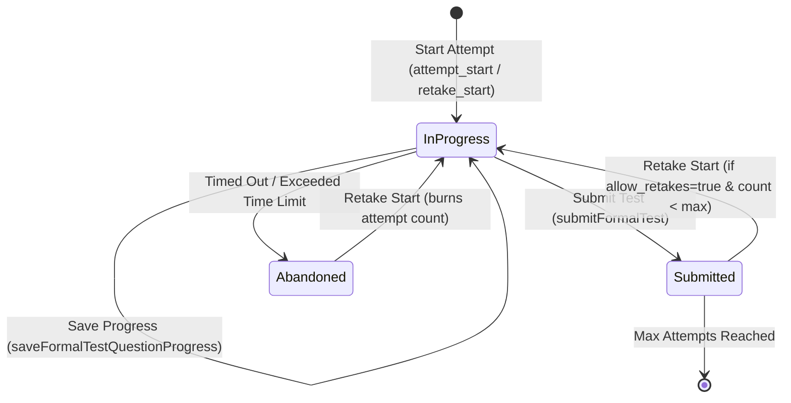

# Stage 1E.2.D.D — Attempt, Retake & Mock-Test Policy Matrix

**Document ID:** `PHASE_1E_2_D_D_ATTEMPT_AND_MOCK_POLICY_MATRIX`  
**Repository:** `E:\Al-Faraabi Software\3peas_backend`  
**Stage:** 1E.2.D.D — Planning and Source Inspection ONLY  
**Timestamp:** 2026-11-19  

---

## 1. Mock-Test Attempt & Accounting Rules

In The Students Times architecture, Mock Tests represent full examination simulations:
1. **Distinction via `test_mode`:**
   - Formal unit/chapter tests have `test_mode = 'test'`.
   - Mock exams have `test_mode = 'mock'`.
2. **Quota Tracking:**
   - Quota tracking uses `exam_type = 'mock'` in `freemium_exam_quotas` and `freemium_quota_consumptions`.
   - Generation of a mock test consumes `1` mock generation quota per window (if dynamic generation is supported).
   - Official mock tests (`test_source = 'official'`, `test_mode = 'mock'`) consume **0** generation quota.
3. **Attempt & Retake Limits:**
   - Governed by campaign `exam_type = 'mock'` settings: `allow_retakes` and `max_attempts_per_test`.
   - Fallback setting: `config('freemium.fallback_quotas.mock')` (defaults to 1 attempt, retakes disabled).
   - Paid students have unlimited attempts and retakes on mock tests within their subscribed program.

---

## 2. Attempt Counting & Sequential Numbering Rules

1. **Sequential Numbering ($1..N$):**
   - Each attempt by student $S$ on test $T$ receives a sequential `attempt_number` ($1, 2, 3...$).
   - Calculation:
     `$attemptNumber = TestAttempt::where('test_id', $testId)->where('user_id', $student->id)->count() + 1;`
   - Initial attempt: `attempt_number = 1`, ledger event `attempt_start`.
   - Subsequent attempt: `attempt_number > 1`, ledger event `retake_start`.
2. **Inclusive Max Attempts:**
   - `max_attempts_per_test` is the total lifetime attempts allowed for that student on that specific test.
   - If `max_attempts_per_test = 1`, only the initial attempt is permitted.
   - If `max_attempts_per_test = 3` and `allow_retakes = true`, the student may execute Attempt #1, Attempt #2, and Attempt #3. Attempt #4 will be rejected.
3. **Multi-Student Isolation on Shared Tests:**
   - Official shared tests (`test_source = 'official'`) are attempted by multiple students.
   - Student A's attempt count does NOT affect Student B's attempt count.
   - Database constraint: Migration `000011` enforces uniqueness on `(test_id, user_id, attempt_number, event_type)`.

---

## 3. Attempt State Lifecycle Transitions

1. **Active Attempt Resumption:**
   - If an attempt is currently `status = 'in_progress'`, calling `saveFormalTestQuestionProgressForLms` continues the active attempt.
   - Zero quota is consumed, and no new row is created in `test_attempts`.
2. **Submitted Immutability:**
   - Once submitted (`status = 'submitted'`), an attempt is permanently locked. No further answer updates can be written to it.
   - Re-submitting returns the existing result with HTTP 200.
3. **Abandoned Attempt Accounting:**
   - If a student leaves an attempt without submitting and starts a new one, the previous attempt is marked abandoned or counted as a completed attempt.
   - It burns 1 attempt from their total `max_attempts_per_test` allowance.
