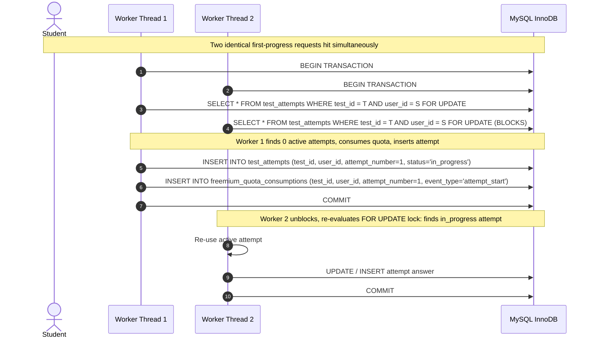

# Stage 1E.2.D.D — Idempotency and Concurrency Design

**Document ID:** `PHASE_1E_2_D_D_IDEMPOTENCY_AND_CONCURRENCY_DESIGN`  
**Repository:** `E:\Al-Faraabi Software\3peas_backend`  
**Stage:** 1E.2.D.D — Planning and Source Inspection ONLY  
**Timestamp:** 2026-11-19  

---

## 1. Concurrency Threats & Serialization Requirements

In high-concurrency environments (e.g. synchronized student exams or retake rushes), race conditions can cause:
1. **Duplicate Attempt Creation:** Two rapid concurrent first-progress requests creating two active `test_attempts` with `attempt_number = 1`.
2. **Double Quota Consumption:** Two threads simultaneously checking quota balance and both recording `attempt_start`.
3. **Ghost In-Progress Records:** Race between progress saving and submission leaving unfinalized orphaned answers.

---

## 2. Hardened Serialization Architecture

### 2.1 First-Progress Attempt Creation Serialization

### 2.2 Database Constraint Guardrail

Even if application-level locking experienced an edge-case failure, database-level uniqueness guarantees zero duplicates:
1. **Table:** `freemium_quota_consumptions`
   - **Index:** `freemium_qc_test_user_attempt_event_unique`
   - **Columns:** `(test_id, user_id, attempt_number, event_type)`
   - **Behavior:** Any second thread attempting to insert `(T, S, 1, 'attempt_start')` throws MySQL error `1062 Duplicate entry`, triggering transaction rollback.

---

## 3. Idempotency Key Engine (`assessment_idempotency_records`)

For generation endpoints (`generateSelectedUnitsPracticeSessionForLms`, `generateFullBookPracticeSessionForLms`, etc.), the `AssessmentIdempotencyRecord` table prevents duplicate actions:
- **Unique Constraint:** `(idempotency_key, action_type)`
- **Behavior:**
  - **Identical Key + Identical Payload:** Returns cached response with exact HTTP status.
  - **Identical Key + Different Payload:** Returns HTTP 409 Conflict.
  - **In-Flight Duplicate:** Second request waits or fails cleanly without double-spending quota.

---

## 4. Concurrency on Read-Only Endpoints

1. **`GET /tests/get-recent-attempts`:**
   - Pure read query. Requires no pessimistic locks (`FOR UPDATE` is strictly avoided to prevent database contention).
   - Reads committed data (`READ COMMITTED` or `REPEATABLE READ`).
   - Query filters by indexed columns: `attempts.user_id` and `attempts.status`.
2. **`GET /freemium/tests/{testId}/eligibility`:**
   - Read-only simulation. Counts existing attempts and checks remaining balances.
   - Zero locks acquired. Safe for high-frequency frontend pre-flight checks.
