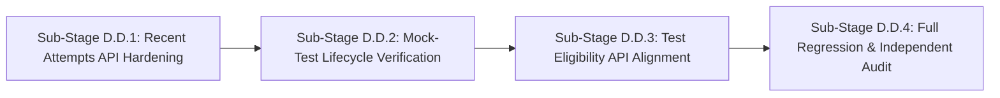

# Stage 1E.2.D.D — Implementation Roadmap & Sub-Stage Breakdown

**Document ID:** `PHASE_1E_2_D_D_IMPLEMENTATION_ROADMAP`  
**Repository:** `E:\Al-Faraabi Software\3peas_backend`  
**Stage:** 1E.2.D.D — Planning and Source Inspection ONLY  
**Timestamp:** 2026-11-19  

---

## 1. Sub-Stage Architecture & Phased Rollout

Stage 1E.2.D.D execution is divided into four distinct, independently verifiable sub-stages:



---

## 2. Detailed Sub-Stage Specifications

### Sub-Stage D.D.1: Recent Attempts API Hardening (`getRecentAttemptsForLms`)
- **Target File:** `app/Http/Controllers/Tests/TestController.php`
- **Scope of Changes:**
  1. Add strict student role and active status validation:
     ```php
     if (!$user || $user->role !== 'student' || $user->status !== 'active') {
         return response()->json([
             'success' => 0,
             'message' => 'Active student account required.',
         ], 403);
     }
     ```
  2. Add `attempts.attempt_number` to `selectRaw` for `test_attempts` query.
  3. Include `'attempt_number' => (int) ($attempt->attempt_number ?? 1)` in mapped JSON response.
  4. Enhance display title formatting: when `test_mode === 'mock'`, prefix or format display title as `Mock Exam: {title}`.
- **Verification:** Create dedicated feature test suite `tests/Feature/Freemium/TestRecentAttemptsHardeningTest.php` covering 9 assertions.

---

### Sub-Stage D.D.2: Mock-Test Lifecycle Verification
- **Target Files:**
  - `app/Http/Controllers/Tests/TestController.php`
  - `app/Http/Services/Freemium/FreemiumQuotaConsumptionService.php`
- **Scope of Changes:**
  1. Verify mock test attempt quota deduction (`exam_type = 'mock'`) during first progress.
  2. Verify retake limits under campaign and fallback policies.
  3. Verify activity logging writes `mock_completed` in `student_activity_tbl`.
- **Verification:** Create dedicated feature test suite `tests/Feature/Freemium/TestMockTestLifecycleTest.php`.

---

### Sub-Stage D.D.3: Test Eligibility API Alignment
- **Target Files:**
  - `app/Http/Controllers/Api/Student/Freemium/StudentFreemiumQuotaController.php`
  - `app/Http/Services/Freemium/FreemiumQuotaConsumptionService.php`
- **Scope of Changes:**
  1. Verify that `getTestAttemptEligibility` accurately returns `test_mode: 'mock'` and uses `exam_type = 'mock'` for quota lookups.
  2. Verify that unowned dynamic tests fail closed with HTTP 404 (`test_not_found`).
  3. Verify that shared official tests correctly return student-specific attempt count and remaining attempts.
- **Verification:** Automated tests covering edge cases and concurrent inquiries.

---

### Sub-Stage D.D.4: Full Regression & Independent Audit
- **Scope:**
  1. Execute entire test suite:
     - 210+ Freemium Feature Tests
     - 37+ Freemium Unit Tests
     - 16+ Subscription Integration Tests
     - All new D.D Feature Tests
  2. Deliver comprehensive independent audit and final completion report.
  3. Confirm zero uncommitted or unwanted changes.
