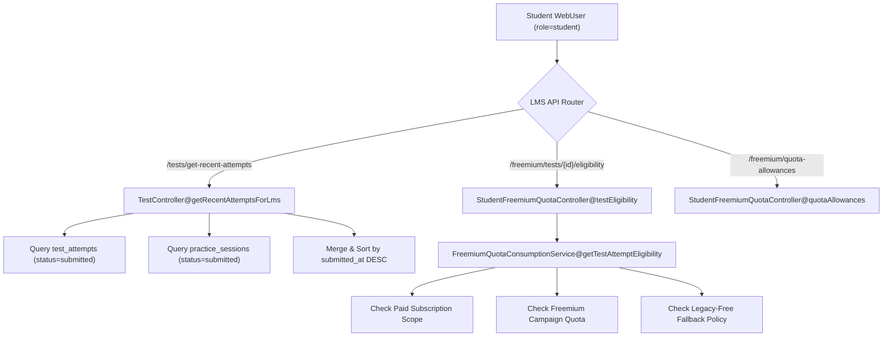
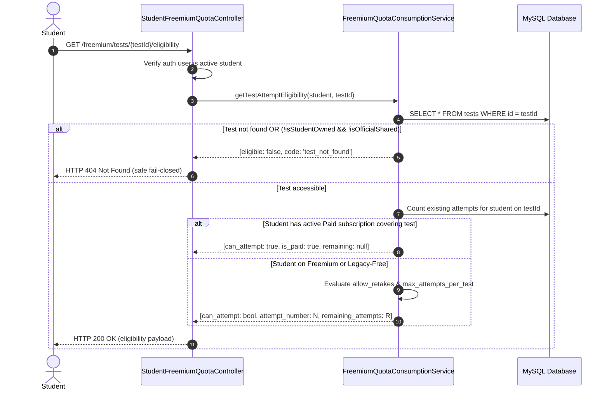
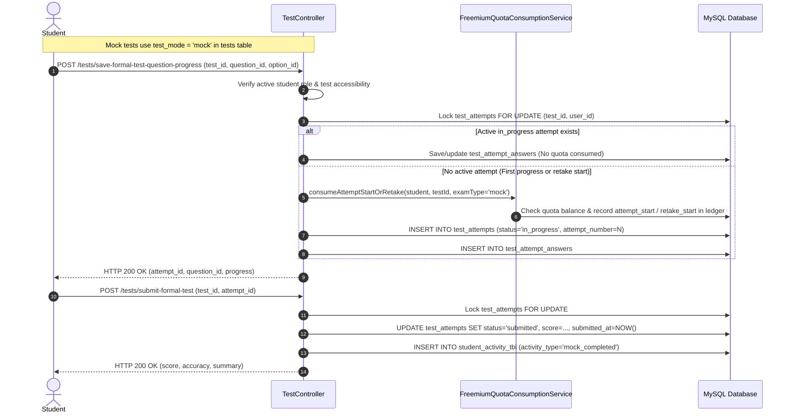

# Stage 1E.2.D.D — Assessment Lifecycle and Call Flows

**Document ID:** `PHASE_1E_2_D_D_LIFECYCLE_AND_CALL_FLOWS`  
**Repository:** `E:\Al-Faraabi Software\3peas_backend`  
**Stage:** 1E.2.D.D — Planning and Source Inspection ONLY  
**Timestamp:** 2026-11-19  

---

## 1. Unified Assessment Architecture & Entity Boundaries



---

## 2. Call Flows & Sequence Details

### 2.1 Recent Attempts Query Flow (`getRecentAttemptsForLms`)

```mermaid
sequenceDiagram
    autonumber
    actor Student
    participant API as TestController
    participant DB as MySQL Database

    Student->>API: GET /tests/get-recent-attempts?limit=10&subject_id=5
    Note over API: Security Gap: Currently lacks role='student' check
    API->>API: Validate input (limit: 1-20, program_id, subject_id)
    API->>DB: SELECT test_attempts JOIN tests (user_id = student.id, status = 'submitted')
    API->>DB: SELECT practice_sessions (user_id = student.id, status = 'submitted')
    Note over API: Gaps: attempt_number not selected; mock test title not formatted
    API->>API: Map practice display title, concat formal & practice, sort DESC by submitted_at
    API->>API: Slice top :limit records
    API-->>Student: HTTP 200 OK (data: recent_attempts array)
```

### 2.2 Test Eligibility Flow (`getTestAttemptEligibility`)



### 2.3 Mock Test Execution Lifecycle Flow



---

## 3. Teacher Classroom Tests vs. Freemium Assessment Boundary

Teacher-created classroom tests (Phase 7D) operate completely outside the student freemium quota ledger:
1. **Separation of Tables:** Teacher tests use `teacher_class_test_assignments`, `teacher_class_test_recipients`, and `teacher_class_test_attempts`. They never write to `tests`, `test_attempts`, or `freemium_quota_consumptions`.
2. **Access Control:** Gated strictly by classroom enrollment (`TeacherClassEnrollment`), teacher active status, and class schedule window (`starts_at`, `due_at`, `cutoff_at`).
3. **Attempt Accounting:** Attempt counting is managed by `TeacherClassTestAssignment::max_attempts` configured by the assigning teacher, completely independent of Freemium campaign policies.
4. **Zero Quota Burn:** Enrolled students taking teacher classroom tests burn **0** Freemium weekly quotas.
