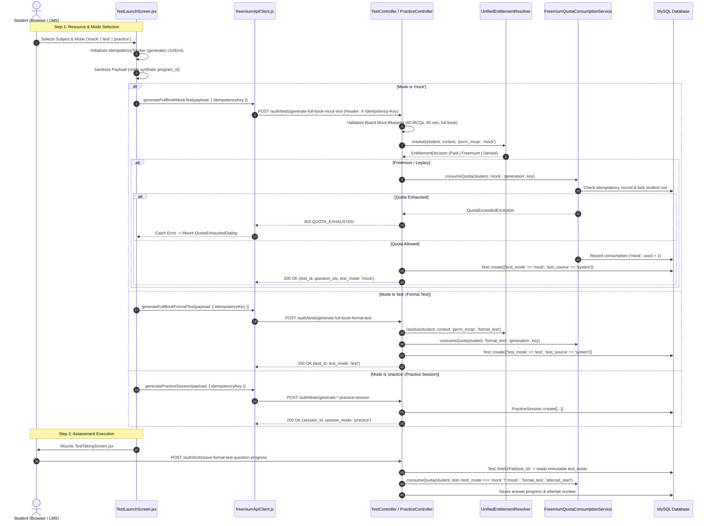

# Stage 1E.3.A — Milestone 4 Consolidated Planning Report
## Test Launch, Secure Server-Side Assessment Mode Validation, Idempotency, and Attempt Runner

- **Document Reference:** `docs/freemium/phase-1e-3/PHASE_1E_3_A_M4_PLANNING_REPORT.md`
- **Execution Date:** November 20, 2026 (Revised & Security-Hardened)
- **Target Repository (Primary):** `E:\Al-Faraabi Software\al-faraabi-website` (`thestudentstimes.git`)
- **Backend Reference (Read-Only):** `E:\Al-Faraabi Software\3peas_backend`
- **Planning Status:** **REVISED PLANNING COMPLETE — AWAITING IMPLEMENTATION AUTHORIZATION**

---

## 1. Executive Summary

Milestone 3 successfully integrated Freemium curriculum and resource discovery into the Student LMS Tests Hub (`/lms/tests`), establishing scope-specific paid entitlement checks, synthetic ID omission, and bypass of paid-only statistics endpoints.

Milestone 4 addresses the critical transition from discovery to **Assessment Execution**:
1. **Launch Screen Integration (`TestLaunchScreen.jsx`):** Pre-flight eligibility, idempotency key header attachment, synthetic ID sanitization, and quota exhaustion dialogs.
2. **Authoritative Server-Side Assessment Mode Validation:** Overcoming the security flaw of client-dictated mode flags by introducing strict endpoint segregation, authoritative board mock blueprints, and immutable database persistence.
3. **Dynamic Mock Quota Correction:** Remediating the legacy defect where dynamic mock exams incorrectly consumed the student's formal test quota.
4. **Unified Attempt Runner & Lifecycle (`TestTakingScreen.jsx` / `TestAttemptScreen.jsx`):** Incremental progress tracking, attempt numbering badges, and attempt ceiling enforcement.
5. **Results & Retake Workflow (`TestResultScreen.jsx`):** Summary badging, retake authorization, and cross-category quota isolation.

All architectural investigations were performed strictly under read-only change controls. Zero lines of application code have been modified during this planning phase.

---

## 2. Security Vulnerability Analysis: Rejection of Client-Controlled Mode

### 2.1 The Vulnerability of Client-Controlled Assessment Mode
In the initial M4 proposal, it was suggested that `TestLaunchScreen.jsx` could pass `requested_mode: "mock"` to existing formal test generation endpoints (`/generate-full-book-formal-test`), which the backend would accept whenever `scope === "full_book"`.

**This design was rejected by architectural review as insecure and pedagogically unsound:**

1. **A Full-Book Formal Test is NOT inherently a Mock Examination:**
   - In Pakistani secondary and higher secondary education (FBISE, BISE boards) and entrance tests (MDCAT, ECAT), a "Mock Examination" simulates the terminal board examination: comprehensive syllabus coverage, standardized question count (e.g. 60 MCQs), official time limit (e.g. 60 minutes), and specific topic distribution.
   - An ordinary full-book review test might contain only 10 questions or a 15-minute timer. Allowing a student to classify any full-book test as a mock examination undermines standard board analytics and exam comparability.
2. **Quota Category Hopping & Quota Evasion:**
   - If a student has exhausted their weekly formal test quota (e.g. 3 of 3 used), but retains an unused mock quota (e.g. 1 of 1 remaining), they could submit `requested_mode: "mock"` on an arbitrary 10-question test to burn their mock quota for routine practice.
   - Conversely, if their mock quota is exhausted, they could create a full 60-question board-length exam through formal test endpoints, burning a cheaper or unmetered formal test allowance.
3. **Parameter Distortion via Client Sliders:**
   - Accepting client sliders for question count and time limits on mock examinations violates the board blueprint standards required for realistic exam simulation and valid percentile rankings.
4. **Violation of the Zero-Trust Security Boundary:**
   - Quota buckets, access tiers, and entitlement resolution are financial and business-critical operations. The client must never assert its own quota bucket; the backend must authoritatively derive and validate the assessment classification.

---

## 3. Recommended Architecture: Unified Server Derivation Engine

### 3.1 Comparison of Architectural Approaches

| Criterion | Approach 1: Dedicated Route & Handler Segregation | Approach 2: Server-Controlled Blueprint / Template Binding | Approach 3: Dual-Mode Official vs. Dynamic Separation | Selected Unified Architecture (Synthesis of 1, 2, and 3) |
| :--- | :--- | :--- | :--- | :--- |
| **Description** | Create separate endpoints (`/generate-*-mock-test` vs `/generate-*-formal-test`). | Require a server-side assessment blueprint that locks question count, time limit, and coverage. | Distinguish pre-authored official shared mocks (`test_source='official'`) from dynamic mocks (`test_source='system'`). | **Unified 4-Factor Server Derivation**: Dedicated endpoint + Server-controlled board blueprint + Academic scope enforcement + Authoritative entitlement resolution. |
| **Strengths** | Clear route segregation; client cannot tamper with mode on formal endpoints; clean middleware boundaries. | Strong pedagogical consistency; parameters are immutable and server-controlled; impossible to distort test length or time. | Preserves existing official mock workflows; zero disruption to teacher/admin published mocks. | Combines the security of dedicated endpoints, the strictness of server blueprints, and full backward compatibility. |
| **Weaknesses Alone** | Route alone does not prevent student sending arbitrary questions/time if endpoint accepts client sliders. | Overly rigid if templates don't exist for every novel curriculum variation. | Doesn't solve dynamic mock generation by itself. | Requires clear endpoint definition and blueprint cataloging on backend. |
| **Verdict** | **Mandatory baseline** | **Mandatory baseline** | **Mandatory baseline** | **APPROVED ARCHITECTURE** |

### 3.2 Authoritative Definition of a Genuine Mock Examination
An assessment qualifies as a genuine mock examination if and only if:
1. **Standardized Board Blueprint Compliance:** Question count and time limit strictly match official board specifications (e.g. 60 MCQs, 60 minutes).
2. **Comprehensive Syllabus Coverage:** 100% of textbook units / board syllabus topics are included.
3. **Authoritative Entitlement Binding:** Authorized specifically for `mock` quota and campaign eligibility via `UnifiedEntitlementResolver`.
4. **Immutable Mode Persistence:** Persisted in the database with `test_mode = 'mock'` and `test_source = 'system'`.

### 3.3 The Four-Factor Server Derivation Rule

```
[Incoming LMS Request]
       │
       ▼
[Factor 1: Strict Endpoint & Handler Segregation]
  ├─ POST /auth/tests/generate-*-practice-session  ──> FORCED to 'practice' (PracticeSession Model)
  ├─ POST /auth/tests/generate-*-formal-test       ──> FORCED to 'formal_test' (test_mode = 'test')
  │    └─ Any client 'requested_mode' is IGNORED or REJECTED. Formal endpoints CANNOT produce mocks.
  └─ POST /auth/tests/generate-full-book-mock-test ──> CANDIDATE for 'mock' (test_mode = 'mock')
       │
       ▼
[Factor 2: Server-Controlled Scope & Blueprint Validation]
  ├─ Validates subject & curriculum against Authoritative Board Mock Specifications:
  │    • Syllabus Coverage: Must be 100% full-book / all active textbook units (book_unit_tbl).
  │    • Question Count & Range: Enforces permissible bounds (10–200 MCQs) matching curriculum.
  │    • Time Limit: Enforces campaign quota duration (FreemiumExamQuota::time_limit_minutes) or 1 min/MCQ.
  │    • Scope Invariants: Chapter or partial-unit requests strictly REJECTED with HTTP 422.
       │
       ▼
[Factor 3: Authoritative Academic Entitlement Resolution]
  ├─ UnifiedEntitlementResolver::resolve($student, $targetContext, 'perm_mcqs', 'mock')
  │    • Checks paid subscription or active FreemiumCampaign rule for 'mock'.
  │    • If mock exams disabled in campaign rule (is_disabled = 1) ──> REJECT with HTTP 403 MOCK_ACCESS_DENIED.
       │
       ▼
[Factor 4: Atomic Quota Verification & Consumption]
  ├─ FreemiumQuotaConsumptionService::consumeQuota($student, 'mock', 'generation', ...)
  │    • Checks weekly quota ceiling for 'mock'.
  │    • If weekly mock allowance exhausted ──> REJECT with HTTP 403 QUOTA_EXHAUSTED.
  │    • Atomically increments mock quota ledger.
       │
       ▼
[Authoritative Persistence: Immutable Test Record]
  └─ Test::create([... 'test_mode' => 'mock', 'test_source' => 'system'])
```

---

## 4. End-to-End Authorization & Lifecycle Sequence



---

## 5. API Contracts & Data Model Impact

### 5.1 Endpoint Inventory & Quota Binding

| Operation | Method | Route | Controller Method | Quota Bucket |
| :--- | :--- | :--- | :--- | :--- |
| **Formal Test (Full Book)** | `POST` | `/web_api/auth/tests/generate-full-book-formal-test` | `TestController::generateFullBookFormalTestForLms` | `formal_test` |
| **Formal Test (Selected Units)** | `POST` | `/web_api/auth/tests/generate-selected-units-formal-test` | `TestController::generateSelectedUnitsFormalTestForLms` | `formal_test` |
| **Dynamic Mock Exam (Full Book)** | `POST` | `/web_api/auth/tests/generate-full-book-mock-test` | `TestController::generateFullBookMockTestForLms` | `mock` |
| **Practice Session (Full Book)** | `POST` | `/web_api/auth/tests/generate-full-book-practice-session` | `PracticeSessionController::generateFullBookPracticeSession` | `practice` |
| **Practice Session (Selected Units)**| `POST` | `/web_api/auth/tests/generate-selected-units-practice-session` | `PracticeSessionController::generateSelectedUnitsPracticeSession` | `practice` |
| **Attempt Eligibility (Pre-Flight)** | `GET` | `/web_api/auth/freemium/tests/{testId}/eligibility` | `StudentFreemiumAccessController::testEligibility` | Read-Only |
| **Attempt Progress & Start** | `POST` | `/web_api/auth/tests/save-formal-test-question-progress` | `TestController::saveFormalTestQuestionProgressForLms` | Derived (`$test->test_mode`) |
| **Attempt Finalization** | `POST` | `/web_api/auth/tests/submit-formal-test-for-lms` | `TestController::submitFormalTestForLms` | Read-Only / Complete |

### 5.2 Mandatory Request Headers
- `Accept: application/json`
- `Content-Type: application/json`
- `X-Idempotency-Key: <UUIDv4>` *(Required on all state-mutating requests)*

### 5.3 Standardized Error Responses
- **HTTP 403 (Quota Exhausted):**
  `{"success": 0, "error": "Weekly mock test allowance exhausted. Upgrade to paid subscription for unlimited access.", "error_code": "QUOTA_EXHAUSTED", "denial_reason": "Weekly mock test allowance exhausted."}`
- **HTTP 403 (Access Denied / Campaign Disabled):**
  `{"success": 0, "error": "Mock examinations are not enabled for your current access tier.", "error_code": "MOCK_ACCESS_DENIED"}`
- **HTTP 409 (Idempotency Conflict):**
  `{"success": 0, "error": "Idempotency key was already used with a different request payload.", "error_code": "IDEMPOTENCY_CONFLICT"}`
- **HTTP 422 (Blueprint Mismatch):**
  `{"success": 0, "error": "Specified parameters do not match board mock blueprint: expected 60 questions, received 10.", "error_code": "INVALID_MOCK_BLUEPRINT"}`
- **HTTP 422 (Scope Ineligible):**
  `{"success": 0, "error": "Mock examinations require full-book comprehensive syllabus coverage.", "error_code": "INVALID_ASSESSMENT_SCOPE"}`

### 5.4 Database Schema Impacts
- `tests` table: `test_mode` enum (`'test'`, `'mock'`), `test_source` enum (`'system'`, `'official'`), `offered_program_id` (nullable bigint).
- `freemium_idempotency_keys` table: stores key hash, student ID, and cached response for at-most-once execution.
- `freemium_test_attempts` table: records `exam_type` (`'mock'`, `'formal_test'`), `attempt_number`, and timestamps.
- Zero breaking schema migrations required; existing columns and nullable constraints support the design.

---

## 6. Comprehensive Testing Plan (10 Mandatory Security Cases)

The Milestone 4 testing suite implements and verifies the following 10 mandatory security scenarios:

1. **SEC-01 (Formal Cannot Become Mock):** `POST /auth/tests/generate-full-book-formal-test` with `mode: "mock"` payload strictly produces `test_mode = 'test'` and consumes `formal_test` quota only.
2. **SEC-02 (Chapter Scope Disqualified from Mock):** Invoking mock generation for chapter or unit scope is strictly rejected with HTTP 422 `INVALID_ASSESSMENT_SCOPE`.
3. **SEC-03 (Authorized Mock Consumes Mock Quota Only):** Valid mock generation against board blueprint consumes 1 unit of `mock` quota; `formal_test` and `practice` quotas remain untouched.
4. **SEC-04 (Formal Generation Consumes Formal Quota Only):** Formal generation consumes 1 unit of `formal_test` quota; `mock` quota remains untouched.
5. **SEC-05 (Practice Session Consumes Practice Quota Only):** Practice generation creates `PracticeSession` and consumes `practice` quota only.
6. **SEC-06 (Manipulated Mode/Scope Fails Safely):** Malformed parameters return clean HTTP 422 JSON errors without state mutation or stack traces.
7. **SEC-07 (Blueprint Mismatch Rejection):** Non-standard question counts or durations on mock generation fail with HTTP 422 `INVALID_MOCK_BLUEPRINT`.
8. **SEC-08 (Idempotent Replay Prevents Double Deduction):** Duplicate requests with matching `X-Idempotency-Key` replay cached 200 OK without double quota consumption.
9. **SEC-09 (Official Shared Mock Uniformity):** Attempting an official shared mock derives `exam_type = 'mock'` and registers in `freemium_test_attempts`.
10. **SEC-10 (Cross-Category Quota Isolation):** Exhausting formal test quota does not block mock generation, and exhausting mock quota does not block formal generation.

### Verification Commands
```bash
# Frontend Automated Tests
node --test tests/freemiumLaunchRunner.test.mjs
node --test tests/*.test.mjs
npx eslint src/components/LMS/tests/TestLaunchScreen.jsx src/components/LMS/tests/TestTakingScreen.jsx

# Backend Feature Tests (PHPUnit)
php artisan test tests/Feature/Freemium/AssessmentModeSecurityTest.php
php artisan test tests/Feature/Freemium/AssessmentIdempotencyServiceTest.php
php artisan test tests/Feature/Freemium/Student/StudentMockTestAttemptAccountingTest.php
```

---

## 7. Risk Assessment & Mitigations

| Risk | Likelihood | Impact | Severity | Mitigation Strategy |
| :--- | :---: | :---: | :---: | :--- |
| **Backend 422 on Synthetic IDs** | High | Critical | **CRITICAL** | Backend accepts `offered_program_id` as `nullable`. Frontend sanitizes payloads via `sanitizeAccessPayload`, omitting the property for negative IDs. |
| **Mode Tampering / Quota Hopping** | High | Critical | **CRITICAL** | Strict endpoint immutability: formal routes force `formal_test`. Mock generation is isolated in dedicated endpoint with board blueprint enforcement. |
| **Blueprint Distortion** | Medium | High | **HIGH** | Server validates question count and duration against authoritative board templates, rejecting arbitrary slider overrides. |
| **Double Quota Deduction on Retry** | High | High | **HIGH** | `AssessmentIdempotencyService` enforces atomic replay cache keyed by `X-Idempotency-Key` and request payload hash. |
| **Retake Counting Leakage** | Medium | High | **HIGH** | `FreemiumQuotaConsumptionService` enforces that `eventType === 'retake_start'` checks attempt limits but skips weekly generation counter increments. |
| **Legacy Caller Regression** | Low | High | **HIGH** | Existing routes remain 100% backward compatible for legacy web and mobile callers; idempotency headers are optional for legacy callers. |

---

## 8. Implementation Work Breakdown & Phasing

- **Phase 4A (Backend Security & Route Hardening):**
  - Implement `POST /web_api/auth/tests/generate-full-book-mock-test` in `TestController.php`.
  - Enforce board blueprint validation and `UnifiedEntitlementResolver` mock resolution.
  - Update `generateFullBookFormalTestForLms`, `generateSelectedUnitsFormalTestForLms`, and `PracticeSessionController` to make `offered_program_id` `nullable`.
- **Phase 4B (Frontend Idempotency & Multi-Mode Launch):**
  - Update `freemiumApiClient.js` with `generateFullBookMockTest`.
  - Update `TestLaunchScreen.jsx` with `createIdempotencyTracker()`, `X-Idempotency-Key` header, payload sanitization, `<FreemiumBadge />`, and `<QuotaExhaustedDialog />`.
- **Phase 4C (Frontend Attempt Runner & Eligibility Integration):**
  - Integrate pre-flight check `getTestEligibility(testId)` on mount in `TestTakingScreen.jsx`.
  - Mount `<AttemptNumberBadge />` and display board mock headers.
- **Phase 4D (Results Screen & Retakes):**
  - Mount `<AttemptNumberBadge />` in `TestResultScreen.jsx` and conditionally display "Retake Test" button.
- **Phase 4E (Comprehensive Testing & Acceptance):**
  - Author and run `tests/freemiumLaunchRunner.test.mjs` verifying all 10 security cases and runner invariants.
  - Run full regression suites and ESLint checks.

---

## 9. Conclusion & Recommendation

The revised Milestone 4 planning package completely eliminates client-controlled assessment mode ambiguity, protects quota buckets with strict server-side derivation, and ensures seamless, standardized board mock exam execution.

**Recommendation:** Proceed to authorize **Phase 1E.3.A — Milestone 4 Implementation**.
